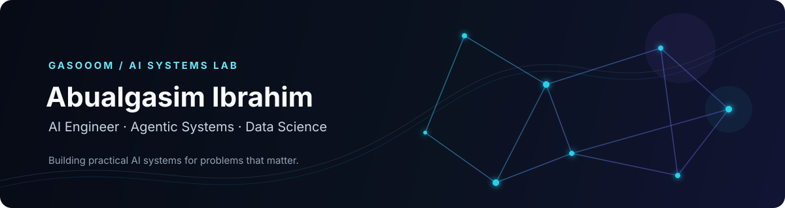
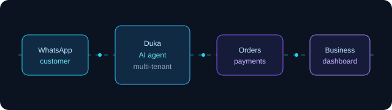
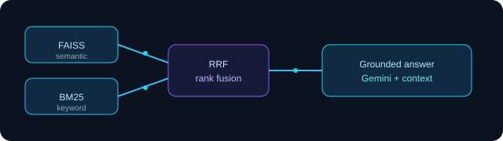
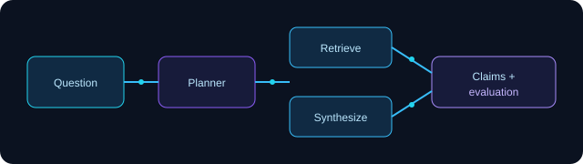
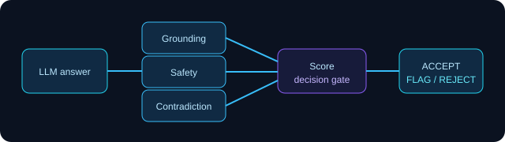
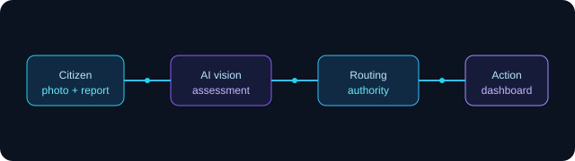
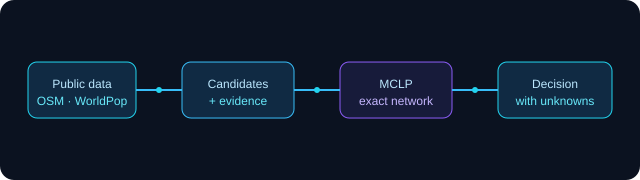

  

  
  
  

 

## Building practical AI systems

I’m **Abualgasim Ibrahim (Gasim)** — a Computer Science student specializing in Data Science and an AI engineer in development.

I design and build systems that move beyond model demos: retrieval pipelines, agentic workflows, evaluation layers, decision engines, and AI-powered products. My work sits at the intersection of **Generative AI, LLM applications, data, backend engineering, and useful technology for emerging markets**.

> **I don’t just experiment with AI. I build systems that solve real problems.**

Currently building **Duka**, a multi-tenant WhatsApp AI commerce platform.

## Selected Projects — Systems Built to Solve Real Problems

<table>
  <tr>
    <td width="50%" valign="top">
      
      <h3><a href="https://github.com/Gasooom/duka">Duka</a></h3>
      
<strong>WhatsApp commerce infrastructure for multiple businesses.</strong> One backend, agent, and toolset can be configured per business, with catalog search, checkout, payments, owner workflows, and tenant isolation.

      
Python · FastAPI · PostgreSQL + pgvector · Next.js · WhatsApp Cloud API · Docker

      <a href="https://github.com/Gasooom/duka">Repository →</a>
    </td>
    <td width="50%" valign="top">
      
      <h3><a href="https://github.com/Gasooom/ContextIQ">ContextIQ</a></h3>
      
<strong>Hybrid RAG for grounded document question-answering.</strong> Semantic retrieval and BM25 keyword search are fused with Reciprocal Rank Fusion before context is sent to Gemini.

      
Python · FastAPI · FAISS · BM25 · Sentence Transformers · Gemini · Streamlit

      <a href="https://github.com/Gasooom/ContextIQ">Repository →</a>
    </td>
  </tr>
  <tr>
    <td width="50%" valign="top">
      
      <h3><a href="https://github.com/Gasooom/researchos">ResearchOS</a></h3>
      
<strong>Evidence-grounded multi-agent research.</strong> Plans work, retrieves sources, produces traceable claims, evaluates output, records failures, and routes uncertainty for human review.

      
Python · LangGraph · FastAPI · SQLite · Tavily · OpenAI · Evaluation

      <a href="https://github.com/Gasooom/researchos">Repository →</a>
    </td>
    <td width="50%" valign="top">
      
      <h3><a href="https://github.com/Gasooom/groundguard">GroundGuard</a></h3>
      
<strong>An auditable reliability layer for LLM applications.</strong> Evaluates grounding, relevance, contradiction, PII, prompt injection, and safety before returning ACCEPT, FLAG, or REJECT.

      
Python · FastAPI · SQLite · Docker · Evaluation pipelines · Safety checks

      <a href="https://github.com/Gasooom/groundguard">Repository →</a>
    </td>
  </tr>
  <tr>
    <td width="50%" valign="top">
      
      <h3><a href="https://github.com/Gasooom/Hanabneho">Hanabneho</a></h3>
      
<strong>AI-assisted civic reporting for recovery operations.</strong> Turns a citizen photo and description into a structured damage assessment, authority recommendation, and dashboard workflow.

      
Next.js · React · TypeScript · FastAPI · SQLAlchemy · LangGraph · GPT-4.1 Vision

      <a href="https://hanabneho-pied.vercel.app">Live demo →</a> · <a href="https://github.com/Gasooom/Hanabneho">Repository →</a>
    </td>
    <td width="50%" valign="top">
      
      <h3><a href="https://github.com/Gasooom/sitescout">SiteScout</a></h3>
      
<strong>EV charging network intelligence for Rwanda.</strong> Uses public data, deterministic scoring, exact maximum-coverage optimization, typed evidence, and an AI layer that explains rather than changes decisions.

      
Python · PuLP · CBC · OpenStreetMap · WorldPop · GeoPandas · Evidence validation

      <a href="https://sitescout-investigation.onrender.com/app/index.html">Live demo →</a> · <a href="https://github.com/Gasooom/sitescout">Repository →</a>
    </td>
  </tr>
</table>

<a href="https://github.com/Gasooom?tab=repositories">View all repositories →</a>

## Technical arsenal

| Area | Tools and methods |
| --- | --- |
| **AI & ML** | Python · Generative AI · LLM applications · AI agents · Vision workflows |
| **Retrieval & reliability** | RAG · LangGraph · LangChain · FAISS · BM25 · pgvector · Evaluation · Grounding |
| **Data & decision systems** | Pandas · NumPy · SQL · SQLite · PostgreSQL · Data visualization · Optimization |
| **Backend & product engineering** | FastAPI · REST APIs · Pydantic · Next.js · TypeScript · Docker · Git · CI |

These are drawn from the implementations and documentation in my public repositories rather than from a generic badge list.

## Engineering principles

- **Evidence over assertion.** Systems should expose where an answer, recommendation, or number came from.
- **Determinism where it matters.** Decision authority belongs in inspectable rules and evaluation, not an opaque model call.
- **AI inside a real workflow.** A useful product needs APIs, persistence, observability, and an interface that fits its users.
- **Measure the failure modes.** Limitations and weak benchmark results are part of the engineering record, not something to hide.

## Activity

  
  

If the external cards are unavailable, my <a href="https://github.com/Gasooom?tab=repositories">repositories</a> and <a href="https://github.com/Gasooom">profile activity</a> remain the source of truth.

## Let’s build something useful

I’m interested in thoughtful collaboration around AI products, agentic systems, data-driven tools, and reliable software for real-world constraints.

  <a href="https://www.linkedin.com/in/abualgasim-ibrahim-828183226/">LinkedIn</a>
  &nbsp;·&nbsp;
  <a href="mailto:aboelgasimibrahim999@gmail.com">Email</a>
  &nbsp;·&nbsp;
  <a href="https://github.com/Gasooom?tab=repositories">Selected repositories</a>

    
  <em>Building useful AI systems, one experiment at a time.</em>

